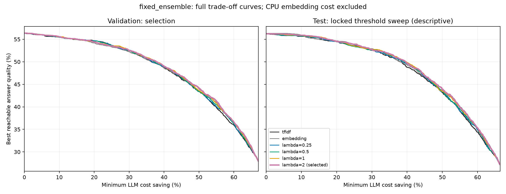
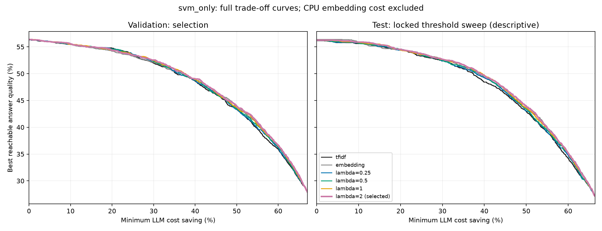
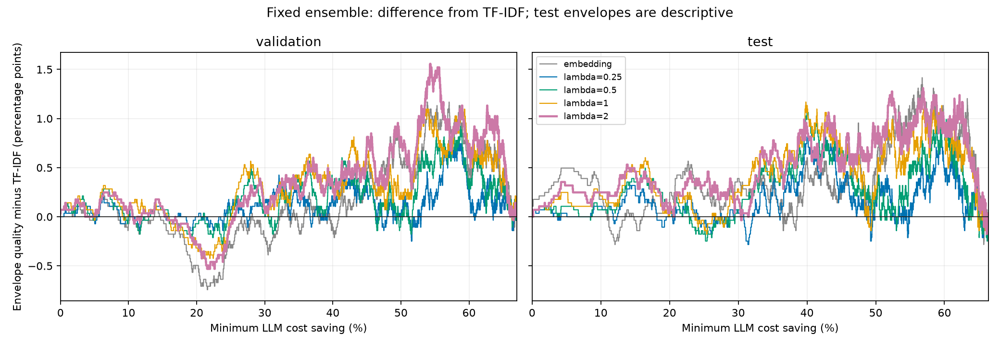
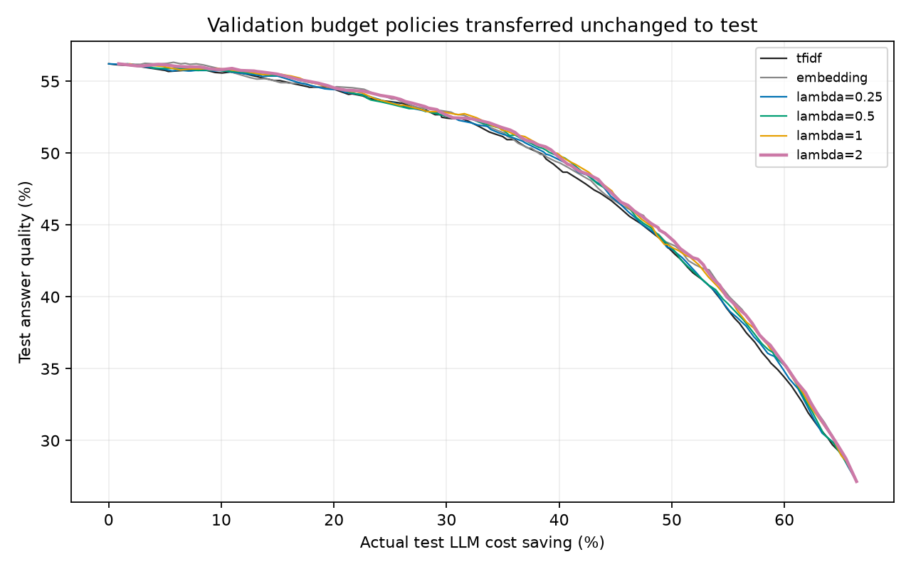

# Trọng số MiniLM λ và toàn bộ đường Answer Quality–Cost Saving

## Lựa chọn đã khóa trên validation

- **λ được chọn: 2**, C = 0.1.
- Trong cả sáu biểu diễn, diện tích validation cao nhất: **lambda_2**.
- Cây v1 giữ nguyên; chính: **10% cây + 90% SVM**. SVM riêng chỉ là phân tích bổ sung.
- Thử λ = 0.25 / 0.5 / 1 / 2 và C = 0.1 / 1 / 10. Hai mốc TF-IDF, embedding riêng được thử cùng C: **18 cấu hình**.
- Thời gian huấn luyện/chọn: 270.0 giây; dùng embedding cache cũ.

Trên test, diện tích của λ được chọn cao hơn TF-IDF +0.506 điểm phần trăm
và cao hơn λ=1 +0.095 điểm phần trăm chất lượng trung bình theo budget.
Đây là mức tăng nhỏ trên toàn miền, không có nghĩa tốt hơn tại mọi mức tiết kiệm.
Tiêu chí này khác thí nghiệm trước (tối thiểu chi phí với giới hạn giảm đúng 2 điểm), nên lựa chọn khác không mâu thuẫn với kết quả trước.

## Công thức và tiêu chí diện tích

`X = L2_normalize([TF-IDF, λ × MiniLM])`.
TF-IDF và MiniLM vốn có norm 1; phần MiniLM được nhân λ **trước** chuẩn hóa chung.
Không chuẩn hóa từng block lần nữa sau phép nhân, vì làm vậy sẽ triệt tiêu λ.
λ=1 phải tái tạo xác suất của thí nghiệm kết hợp trước ở cùng C.

Với mỗi ngân sách tiết kiệm tối thiểu b, lấy chất lượng tốt nhất trong các ngưỡng thỏa saving ≥ b:

`Q*(b) = max_threshold AnswerQuality(threshold), subject to CostSaving(threshold) >= b`.

Điểm chọn là `integral Q*(b) db / S_small`, với b từ 0 đến mức tiết kiệm always Mistral.
Miền validation: 0–67.02%. Tích phân chính xác đường bậc thang,
không nội suy thành chính sách trộn chưa triển khai. Diện tích chuẩn hóa là **chất lượng trung bình
trên các yêu cầu tiết kiệm**, không phải accuracy của một ngưỡng hay ROC-AUC.
Mọi mức tiết kiệm có trọng số đều theo độ rộng miền; tiêu chí này có thể ưu tiên λ khác khi chỉ quan tâm vùng 20%.
Miền test dùng mức tiết kiệm always Mistral của test, chung cho mọi variant; không so trực tiếp chênh lệch diện tích validation–test như cùng miền dữ liệu.

| Đầu vào SVM | C chọn | Diện tích chuẩn hóa validation | Diện tích test (mô tả) |
| --- | ---: | ---: | ---: |
| tfidf | 0.1 | 48.2868% | 48.2688% |
| embedding | 0.1 | 48.4308% | 48.6524% |
| lambda_0.25 | 0.1 | 48.4068% | 48.4329% |
| lambda_0.5 | 0.1 | 48.4777% | 48.5424% |
| lambda_1 | 0.1 | 48.5707% | 48.6794% |
| lambda_2 | 0.1 | 48.6206% | 48.7747% |

## Toàn bộ đường đánh đổi

Đường mảnh: mọi ngưỡng. Đường đậm: đường biên chất lượng tốt nhất tại mỗi yêu cầu tiết kiệm.
Mọi score khác nhau đều được xét, gồm hai đầu luôn Mixtral/Mistral; không chỉ quét bước 0.01.
Score bằng nhau được xử lý cùng lúc. Nhánh test **chỉ dùng các ngưỡng đã lưu từ validation**.
Đường biên/diện tích test dùng nhãn test để mô tả kết quả đạt được; không dùng chúng chọn ngưỡng triển khai hoặc chọn lại λ.

### Nhìn rõ chênh lệch khi các đường gần nhau

Đường trên 0 là chất lượng đường biên cao hơn TF-IDF tại cùng yêu cầu tiết kiệm;
đây là so sánh mô tả, không phải khoảng tin cậy hay chính sách được chọn từ test.

## Chính sách chọn trên validation, áp dụng nguyên trạng lên test

Chọn ngưỡng cho 101 mức tiết kiệm cách đều miền validation và thêm các mốc 10/20/30/40/50/60%.
Bảng dưới giữ nguyên ngưỡng đó trên test. Vì phân phối thay đổi, saving test có thể thấp hơn budget validation.
Các hàng cùng budget yêu cầu **không bảo đảm cùng chi phí test thực tế**.

| Budget yêu cầu trên validation | Đầu vào SVM | Ngưỡng khóa | Đúng validation | Tiết kiệm test thực tế | Đúng test |
| ---: | --- | ---: | ---: | ---: | ---: |
| 10% | tfidf | 0.156967 | 55.48% | 8.38% | 55.82% |
| 10% | embedding | 0.163304 | 55.41% | 10.10% | 55.82% |
| 10% | lambda_0.25 | 0.157371 | 55.52% | 8.93% | 55.75% |
| 10% | lambda_0.5 | 0.157359 | 55.48% | 8.93% | 55.75% |
| 10% | lambda_1 | 0.158590 | 55.56% | 9.72% | 55.89% |
| 10% | lambda_2 | 0.154365 | 55.56% | 8.96% | 55.86% |
| 20% | tfidf | 0.202169 | 54.67% | 18.86% | 54.58% |
| 20% | embedding | 0.197727 | 54.18% | 18.92% | 54.55% |
| 20% | lambda_0.25 | 0.200958 | 54.67% | 19.17% | 54.48% |
| 20% | lambda_0.5 | 0.201108 | 54.60% | 19.49% | 54.69% |
| 20% | lambda_1 | 0.193295 | 54.35% | 18.44% | 54.83% |
| 20% | lambda_2 | 0.190007 | 54.39% | 18.61% | 54.87% |
| 30% | tfidf | 0.254084 | 52.44% | 29.49% | 52.67% |
| 30% | embedding | 0.245136 | 52.23% | 28.91% | 53.03% |
| 30% | lambda_0.25 | 0.249723 | 52.58% | 29.20% | 52.78% |
| 30% | lambda_0.5 | 0.242965 | 52.48% | 28.23% | 52.92% |
| 30% | lambda_1 | 0.241054 | 52.55% | 28.89% | 52.88% |
| 30% | lambda_2 | 0.240024 | 52.51% | 29.15% | 53.03% |
| 40% | tfidf | 0.309608 | 48.73% | 38.83% | 49.59% |
| 40% | embedding | 0.310255 | 48.58% | 38.65% | 49.88% |
| 40% | lambda_0.25 | 0.307663 | 48.87% | 38.85% | 49.91% |
| 40% | lambda_0.5 | 0.307200 | 49.04% | 38.85% | 50.19% |
| 40% | lambda_1 | 0.307676 | 49.04% | 39.62% | 50.02% |
| 40% | lambda_2 | 0.307330 | 49.01% | 39.27% | 50.23% |
| 50% | tfidf | 0.384943 | 43.38% | 49.66% | 43.40% |
| 50% | embedding | 0.383613 | 43.95% | 49.31% | 43.93% |
| 50% | lambda_0.25 | 0.386916 | 43.42% | 49.55% | 43.47% |
| 50% | lambda_0.5 | 0.387346 | 43.38% | 49.49% | 43.75% |
| 50% | lambda_1 | 0.387374 | 43.63% | 49.34% | 43.65% |
| 50% | lambda_2 | 0.385032 | 44.20% | 48.91% | 44.64% |
| 60% | tfidf | 0.482627 | 35.95% | 58.78% | 35.40% |
| 60% | embedding | 0.486602 | 36.41% | 58.92% | 36.21% |
| 60% | lambda_0.25 | 0.486720 | 36.16% | 58.77% | 35.96% |
| 60% | lambda_0.5 | 0.492349 | 36.23% | 58.94% | 36.14% |
| 60% | lambda_1 | 0.491558 | 36.59% | 58.50% | 36.67% |
| 60% | lambda_2 | 0.489964 | 36.59% | 58.31% | 36.92% |

### So sánh ghép cặp tại budget validation 20%

- lambda_2 so với tfidf: Δ đúng +0.28 điểm %, CI95% [-0.28, +0.85]; Δ tiết kiệm -0.25 điểm %, cứu 36, mất 28 câu đúng.
- lambda_2 so với lambda_1: Δ đúng +0.04 điểm %, CI95% [-0.32, +0.39]; Δ tiết kiệm +0.17 điểm %, cứu 13, mất 12 câu đúng.

Bootstrap 1000 lần theo nhóm prompt, mô hình và ngưỡng giữ cố định; không điều chỉnh nhiều phép so sánh.
Không diễn giải khác biệt quality thành cải thiện tại cùng chi phí nếu saving test khác nhau.
Các khoảng ở mục này áp dụng cho policy khóa tại budget validation 20%, không phải khoảng tin cậy của toàn đường hay diện tích.

## Giới hạn và tái lập

- Test đã xem trong các thí nghiệm trước: phân tích tiếp nối, không phải holdout độc lập mới.
- Tối ưu đường biên trên validation cũng có thể overfit validation; không chọn lại cấu hình từ test.
- Chi phí LLM là giá trị lưu trong RouterBench, chưa gồm CPU tạo embedding. Không gọi API trả lời.
- TF-IDF fit riêng trong từng fold; encoder đóng băng và không cắt token, cách gộp đoạn giữ nguyên.
- λ điều chỉnh tương quan hai block; C điều chỉnh regularization, vì vậy cả hai được thử cùng lưới.

Xem `docs/SVM_LAMBDA_EXPERIMENT.md` để chạy lại. `protocol.json` ghi thiết kế trước fitting;
`selection.json` khóa λ/C/artifact trước test. `validation_candidates.csv` và `validation_candidate_curves.csv`
ghi tất cả 18 cấu hình. `threshold_curves.csv` chứa mọi ngưỡng của các cấu hình đã chọn;
`pareto_frontiers.csv` và `curve_areas.csv` là tổng hợp. `locked_budget_policies.csv` khóa ngưỡng;
`budget_evaluation.csv` ghi kết quả chuyển ngưỡng sang test; `predictions.csv` đủ để kiểm tra lại.
Ảnh PNG và SVG được lưu cùng báo cáo.
